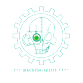
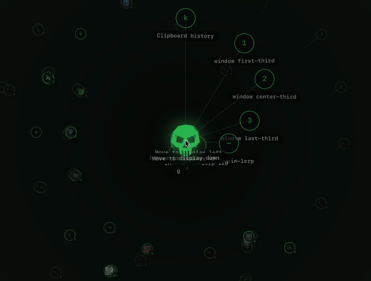
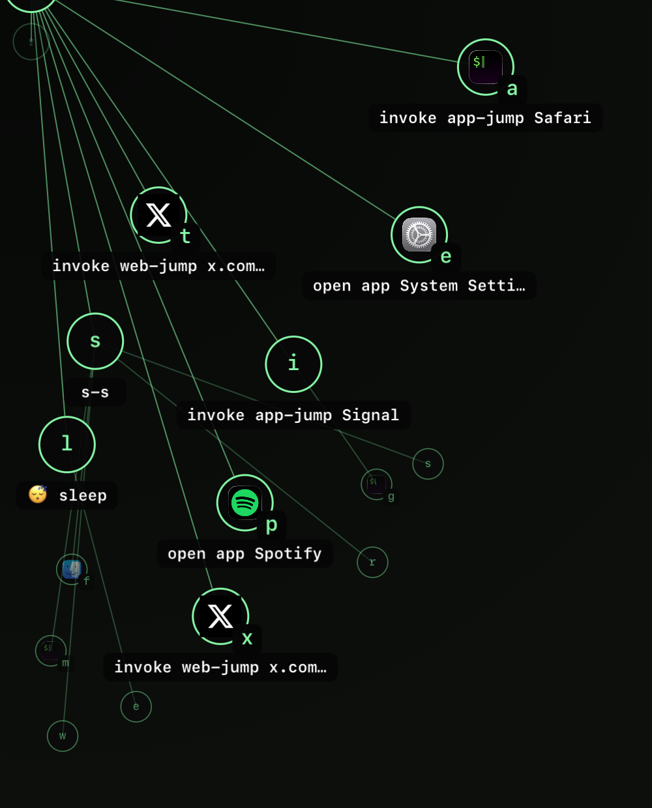
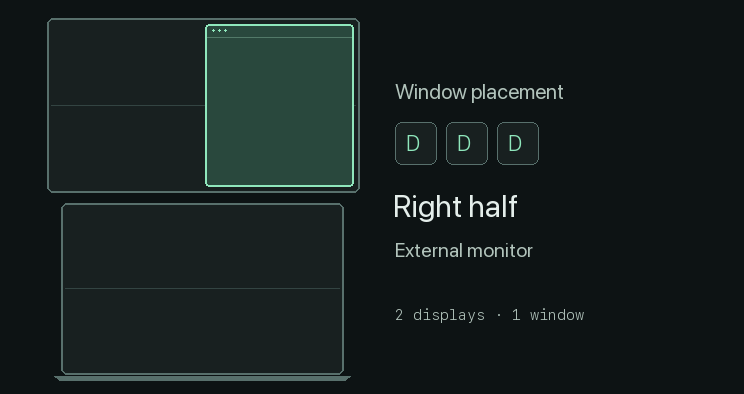
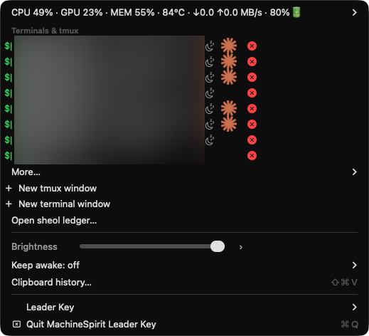
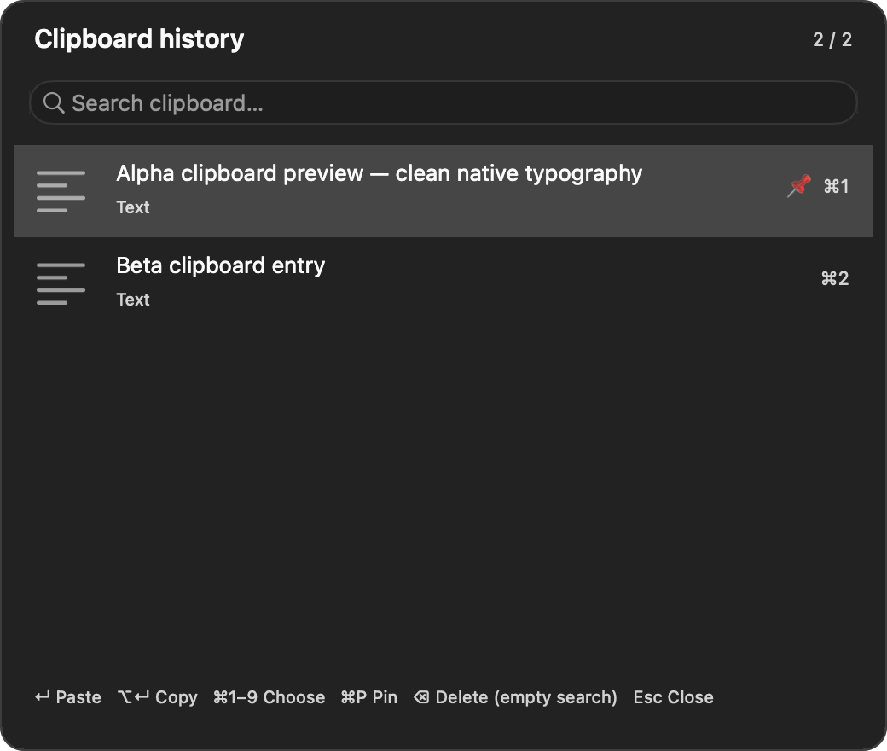
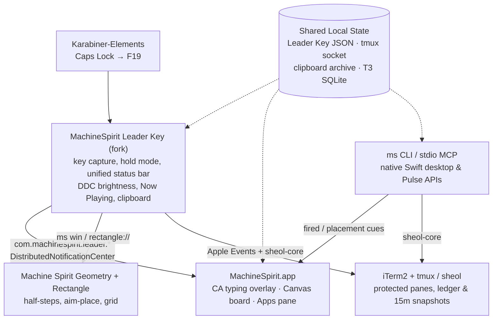

<div align="center">



# machine-spirit

**A native macOS input layer, spatial window grid, unified menu bar, and agent-ready desktop CLI.**<br />
*Keyboard where keyboard wins. Mouse where mouse wins. Never choose.*

[Watch It Move](#a-launcher-you-can-see-as-you-type) · [Spatial Grid](#spatial-window-geometry-across-every-display) · [Unified Menu Bar](#one-menu-bar-item-to-replace-four-utilities) · [Sheol](#sheol--a-necromancers-ledger-for-tmux) · [`ms` CLI & MCP](#ms--native-desktop-geometry-for-scripts--ai-agents) · [Under the Hood](#under-the-hood) · [Full Reference](docs/REFERENCE.md)

</div>

---

<p align="center">
  
</p>

<p align="center">
  <em>Live Core Animation typing overlay on a clean dark canvas: root bloom from Caps Lock, branch drill-down (<code>s</code> → <code>s/s</code>), backspace retraction, <code>g</code> branch focus, and electric-blue completion pulse. Driven by distributed notifications; no live binds were executed.</em>
</p>

---

## Stop Choosing Between Tiling Dogma and Mouse Drift

macOS window tools almost always force an ideological pick. Tiling window managers make the keyboard mandatory and treat reaching for the mouse like a moral failure. Stock macOS makes the mouse mandatory—floating windows pile up until you are dragging rectangles across three monitors by hand.

**machine-spirit** sits in the equilibrium on purpose. You can drive one monitor with the trackpad while firing a spatial chord on another with your left hand. Windows still float. Dragging still works. Nothing macOS does well is taken away—instead, a fast, inspectable, version-controlled keyboard and telemetry layer wraps cleanly around the OS.

Built from owned Swift 6 apps, a hard-forked [Leader Key](forks/LeaderKey), a zero-dependency native CLI/MCP server, and portable captured configs, the entire environment clones onto a fresh Mac with `./install.sh` and self-verifies before every public push.

---

## A Launcher You Can See As You Type

Tap **Caps Lock** (remapped to **F19** via Karabiner-Elements so it never capitalizes) and a click-through, GPU-composited shortcut graph blooms right under your cursor. You don’t memorize opaque modifier chords—you follow a four-tier mnemonic grammar:

1. **One tap** for harmless, frequent actions — `⇪ y` cycles YouTube tabs, `⇪ k` opens clipboard history.
2. **Two-letter mnemonics** for apps and sites — `⇪ s p` for **Sp**otify, `⇪ m e` for **Me**ssages search, `⇪ g m` for **Gm**ail.
3. **Triple letters** for spatial window placement — deliberate friction mapped to the physical keyboard (`⇪ q q q` top-left, `⇪ d d d` right half, `⇪ b b b` center third).
4. **Spelled-out words** for high-consequence actions — `⇪ q u i t` literally makes you spell *quit* to press `⌘Q`, and `⇪ s l e e p` sleeps the display after key release settles.

Keep holding **Caps Lock** after any bind fires and you stay in **Hold Mode**: spam `a` after `⇪ s a` to merge Safari windows, spam `i` after `⇪ f i` to gather Finder windows into tabs, spam `x` after `⇪ t m u x` to spiral terminal splits, or tap `␣` after *any* bind to aim-place and ladder the window by mouse.

<table>
  <tr>
    <td width="50%" align="center">
      
      <br /><sub><b>Live radial neighborhood</b> — children at full size, grandchildren dimmed ahead, ancestors chained back to the skull.</sub>
    </td>
    <td width="50%" align="center">
      
      <br /><sub><b>Edge-aware geometry</b> — anchored near a screen corner, the graph automatically fans inward away from bezels and the menu bar.</sub>
    </td>
  </tr>
</table>

### The Board & Isolated Apps Pane

Open `⇪ m a c h i n e s p i r i t` to inspect or reshape the whole tree on a native SwiftUI Canvas (**MachineSpirit.app**). Walk routes by typing, drag nodes freely between computed `radial` and saved `hand` layouts, watch live keystrokes pulse along the traces, or add/remove binds with **+ / −** through a lossless round-trip write gate that hot-reloads the launcher in 300 ms.

The **Board | Apps** switcher (`machinespirit://apps`) hosts an optional disposable Linux **Tor Browser** session (`⇪ t o r`, via [`bin/tor-session.py`](bin/tor-session.py)). First launch opens connection setup. VPN mode requires a WireGuard profile and keeps the guest kill switch on. Tor-only mode asks for confirmation. A native Mac connection bar shows the session’s VPN state.

<p align="center">
  
</p>

---

## Spatial Window Geometry Across Every Display

<p align="center">
  
</p>

<p align="center">
  <em>Recorded from macOS WindowServer across an external M28U above a MacBook Pro: <code>ddd</code> snaps right half, repeated <code>xxx</code> walks down by half-screen across the display boundary, and <code>www</code> climbs back up.</em>
</p>

Machine Spirit owns multi-display half-steps, mouse-aim placement, fullscreen bounce, and display transfers natively via `ms win`, while dispatching standard grid positions cleanly to Rectangle.

```text
⇪ q q q  top-left      ⇪ w w w  step up (cross-display)     ⇪ e e e  top-right
⇪ a a a  left half     ⇪ ␣ ␣    aim-place at mouse cursor   ⇪ d d d  right half
⇪ z z z  bottom-left   ⇪ x x x  step down (cross-display)   ⇪ c c c  bottom-right
⇪ v/b/n  thirds (or 1/2/3)      ⇪ m m m / a m m m  max / 90%    ⇪ f f f / g g g  next / prev display
⇪ ← ←  ⇪ → →  ⇪ ↑ ↑  ⇪ ↓ ↓  directional display jump        ⇪ = = / - -  smoothstep ±120 px resize
```

Before a window moves, **pre-commit geometry previews** draw a dashed stroke around the target window on the first keystroke and a solid green destination frame on the second—naming both monitors before a cross-display jump. Press `⇪ ␣ m` to toggle native macOS fullscreen, and any subsequent grid chord waits for the window to exit its fullscreen Space before landing.

---

## One Menu Bar Item to Replace Four Utilities

Most macOS power setups accumulate four separate menu-bar daemons—one for hardware stats, one for keep-awake, one for external monitor brightness, and one for clipboard history. Machine Spirit collapses all of them into **one compact, zero-subprocess-at-idle status item** inside the owned Leader Key fork:

<p align="center">
  
</p>

- **T3 Task Pulse:** Live `working/open` count from the local T3 SQLite task registry (clickable in the menu to jump straight into a thread).
- **Hardware Telemetry:** Fixed-width **CPU**, **GPU**, **RAM**, kernel memory pressure (**MPRS** `1/3` · `2/3` · `3/3`, color-coded only on pressure), and Apple Silicon HID/SMC **TEMP**.
- **Smart Storage Columns:** DiskArbitration + IOKit classifies mounted drives (`SSD1`, `SSD2`, `HDD1`, and a separated **TM** Time Machine group), excludes virtual disk images, and refreshes live on mount/unmount.
- **Keep Awake:** Upright skeletal molecule that brightens while active; supports timed or indefinite assertions and survives app restarts.
- **DDC/CI External Brightness:** One inline slider adjusts built-in (`DisplayServices`) and external monitors (`IOAVService` DDC/CI) together—mapping **25–100** to hardware backlight and **0–25** seamlessly into gamma dimming, with one serial queue per display so a slow HDMI/USB-C port never blocks the rest of the desktop.
- **Now Playing Browser Focus:** CoreAudio process taps run *only while the menu is open*, surfacing audible apps and individual audible browser tabs (Safari & Chromium) with clean page titles, host-only favicons, and one-click jump-to-tab.

<table>
  <tr>
    <td width="48%" align="center" valign="top">
      
      <br /><sub><b>Unified system menu</b> — live summary, 8 most recent terminal/tmux sessions with AI-agent marks and triple-tap close wards, inline brightness, keep-awake, and clipboard. <em>(Session text blurred for privacy.)</em></sub>
    </td>
    <td width="52%" align="center" valign="top">
      
      <br /><sub><b>Native clipboard history (<code>⌘⇧V</code> / <code>⇪ k</code>)</b> — instant substring/fuzzy search across 300 items (50 images), pins, <code>⌘1–9</code> quick paste, and strict exclusion of concealed/1Password entries. Local-only.</sub>
    </td>
  </tr>
</table>

---

## Sheol — A Necromancer’s Ledger for tmux

Long-running builds and AI agent loops shouldn’t die because you closed a terminal window. Press **`⇪ t t`** to spawn a tmux-protected iTerm window with a two-word name (like `umbral-sepulchre`), or **`⇪ t d`** to split into one.

Press **`⇪ t m u x`** to summon **sheol**—a single-instance, alternate-screen ledger dividing every spirit into **☀ THE LIVING** (attached) and **⌁ SHEOL** (detached, still breathing in the underworld):

- **`r` Revive** — bind a detached spirit into a fresh iTerm window without leaving the ledger.
- **`c` Commune** — step inside a session temporarily; `Ctrl-b d` drops you right back into the ledger.
- **`d d d` Banish** — a decaying `◆◆◇` triple-tap ward. Banishing a living spirit detaches it safely into sheol; banishing a spirit already in sheol exiles it for good.
- **15-minute `launchd` snapshots** — [`com.machinespirit.tmux-autosave`](config/tmux/com.machinespirit.tmux-autosave.plist) snapshots layouts and scrollback via `tmux-resurrect` synchronously outside tmux’s status-bar lifecycle (preventing partial writes). Restores are always deliberate (`R`), never automatic on boot.
- **Agent-aware safety cues** — both the menu bar and ledger scan each session’s tty process tree to flag running **Claude**, **Codex**, **Grok**, **Gemini**, and other agent CLIs right beside the close ward.

---

## A Terminal With a Pulse

Summoning the iTerm2 hotkey window runs [`shell/splash/splash.zsh`](shell/splash/splash.zsh): 38 pre-rendered multilingual blackletter banners (English, Finnish, Swedish, Old English, Arabic, Paleo-Hebrew), randomized ASCII crests, fastfetch hardware info separated by cuneiform `𒐫`, and philosophical quotes—typed through an ANSI-safe atomic typewriter that stays **100% silent** in normal panes. All heavy font/block-art rendering runs offline once; runtime needs only `zsh`, iTerm2, and `fastfetch`.

---

## `ms` — Native Desktop Geometry for Scripts & AI Agents

[`tools/ms`](tools/ms/) is a standalone, zero-dependency Swift 6 CLI and **stdio MCP server** exposing the exact same display geometry, shortcut graph, audio state, and terminal ledger to shell scripts and AI coding agents:

```bash
./bin/ms screens --json                     # Physical displays, scale, refresh, usable bounds
./bin/ms windows --app Safari --json        # Live window geometry across displays
./bin/ms binds --tree --grep screenshot     # Inspect the live Leader Key tree
./bin/ms run s/s/s/c --dry-run --json       # Resolve or fire configured leaves
./bin/ms audio tile                         # Tile every app currently playing audio
./bin/ms translate-area                     # Drag area -> Vision OCR + on-device Translation
./bin/ms pulse disk --explain               # Local disk delta review (Apple Foundation Models / deterministic)
./bin/ms mcp                                # Stdio MCP server for Claude, Codex, Gemini & other clients
```

Every MCP tool respects strict safety boundaries: no tmux kill/save/restore verbs are exposed, clipboard archive reads require explicit opt-in (`MS_ALLOW_CLIPBOARD=1`), and Pulse telemetry writes strictly to owner-only monthly JSONL files on your Mac. See [`tools/ms/README.md`](tools/ms/README.md) for the complete command and MCP schema guide.

---

## Under the Hood

A few engineering decisions that make the system feel instantaneous and keep it maintainable:

- **Persistent `CALayer` tree, zero idle CPU.** [`6af954c`](https://github.com/legions-dialect6s/machine-spirit/commit/6af954c) replaced frame-by-frame drawing with a prebuilt layer graph (**166 nodes / 1,331 layers**). Keystrokes mutate layer properties and let WindowServer interpolate; interrupted springs resume from live presentation values. Measured warm focus commit median: **0.618 ms**; settled hidden CPU: **0.0%** ([verification report](app/MachineSpirit/Tests/OverlayV3Verification.md)).
- **Four status items collapsed into one.** [`f11431d`](https://github.com/legions-dialect6s/machine-spirit/commit/f11431d) unified skull, sheol, memory, and system indicators behind one 2-second heartbeat, content-change-only repaints, and open-menu-only detail sampling. Observed SystemUIServer average CPU dropped **52.8% → 1.6%** in recorded before/after sessions (an observational interval, not an isolated lab benchmark; see [FORK-NOTES](forks/FORK-NOTES.md#fork-v3-verification-2026-11-19)).
- **Per-display serial DDC/CI queues with trailing-edge coalescing.** [`77577bb`](https://github.com/legions-dialect6s/machine-spirit/commit/77577bb) gives each monitor its own serial queue holding at most one in-flight `IOAVService` write and one pending target value—so dragging a brightness slider across three displays stays fluid even when one monitor takes 100 ms to ACK.
- **Stable local TCC identity.** [`0f652f4`](https://github.com/legions-dialect6s/machine-spirit/commit/0f652f4) signs local rebuilds with a per-machine **MachineSpirit Local Codesign** certificate so Accessibility and Screen Recording permissions survive rebuilds without Apple notarization.
- **Prove the config before replacing it.** [`ConfigWriter`](kit/MachineSpiritKit/Sources/MachineSpiritKit/ConfigWriter.swift) verifies structural JSON round-trip equality (preserving unknown fields), writes a timestamped backup, re-imports a temporary file, and atomically renames it into place.
- **Self-auditing checkpoints & Docs/Visuals Drift Gate.** Committing on `main` with trailer `Checkpoint: ready` triggers [`.githooks/post-commit`](.githooks/post-commit) → [`scripts/push-checkpoint.sh`](scripts/push-checkpoint.sh), which runs `gitleaks`, [`scripts/check-docs-drift.py`](scripts/check-docs-drift.py) (enforcing keybind parity, valid links, metadata-stripped PNGs, visual-audit coverage, and UI-to-screenshot freshness), all Swift & Xcode test suites, and pushes fast-forward to `origin/main`.

---

## Architecture



---

## Quick Start

```bash
git clone https://github.com/legions-dialect6s/machine-spirit ~/machine-spirit
cd ~/machine-spirit
./install.sh
```

> **Requirements:** macOS 26 for the SwiftUI board/kit, macOS 14+ & Swift 6+ for `ms`, and full Xcode to build the owned GUI apps. Review [`Brewfile`](Brewfile) before running—this is an opinionated environment, not a minimal installer. Complete the permission grants and iTerm hotkey profile steps in [`MANUAL-WIRING.md`](MANUAL-WIRING.md).

### Keeping Live Configs in Sync

```bash
./scripts/sync.sh                                      # pull live config -> repo (__HOME__ templated)
python3 scripts/check-docs-drift.py --range origin/main..HEAD --gate
git add -A && git commit -m "Describe change

Checkpoint: ready"                                     # pre-commit gitleaks + post-commit verified push
```

---

## Built With — Multi-Agent Colophon

**machine-spirit** is directed, architected, and daily-driven by its human author in continuous collaboration with multiple AI engineering agents—**Claude**, **Codex**, and **Gemini**—working across SwiftUI, AppKit, Core Animation, IOKit/CoreAudio, AppleScript, zsh, and verification tooling.

- **[Complete Reference Manual](docs/REFERENCE.md)** — every keybind, Hold Mode chord, menu-bar detail, CLI flag, and layout map
- **[Multi-Agent Contract (`AGENTS.md`)](AGENTS.md)** & **[`CLAUDE.md`](CLAUDE.md)** — repo invariants, drift gate, and checkpoint rules
- **[Design Vision](VISION.md)** · **[Change History](docs/CHANGE-HISTORY.md)** · **[Visual & Privacy Audit](docs/VISUAL-AUDIT.md)** · **[Fork Notes](forks/FORK-NOTES.md)** · **[Checkpoints](CHECKPOINTS.md)**

---

## License

MIT — see [`LICENSE`](LICENSE). Vendored forks retain their upstream MIT licenses and attributions in [`forks/FORK-NOTES.md`](forks/FORK-NOTES.md).
