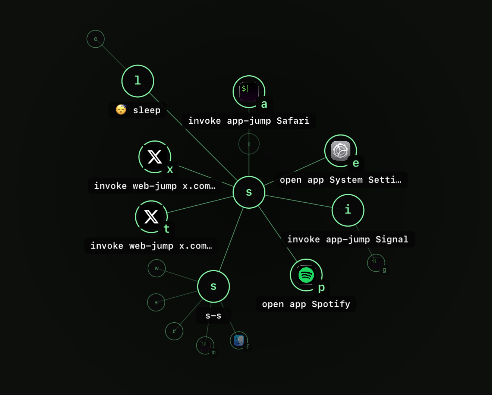
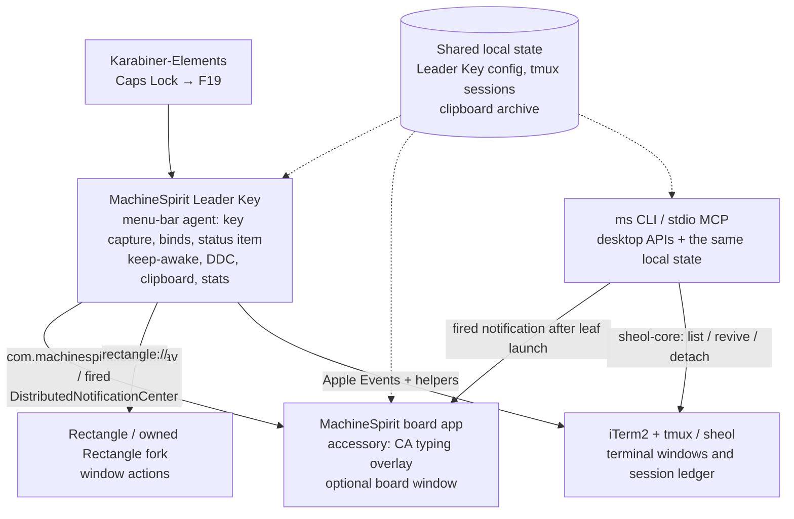
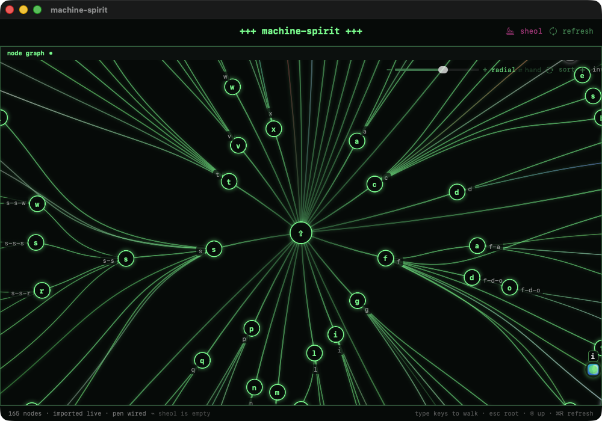

# machine-spirit

A keyboard-driven macOS workspace with a live node-graph launcher, one compact system menu, persistent terminal sessions, and a native CLI/MCP interface for agents.



*The running Core Animation overlay, driven by simulated navigation notifications; no binds were executed for this capture.*

## What it is

- **A launcher you can see as you type.** Caps Lock opens a nested key tree in the owned [Leader Key fork](forks/LeaderKey); a click-through graph follows navigation at the pointer. The optional board lets you inspect, arrange, add, and remove binds. It takes the place of a standalone Leader Key setup while keeping its config format.
- **One compact menu bar item.** Stats, a terminal/tmux ledger, keep-awake, brightness/DDC, and clipboard history share one home. It covers the everyday roles of **Stats**, **Amphetamine**, **MonitorControl**, and **Pastebot/Maccy**; those remain useful standalone alternatives, with different feature sets and hardware coverage.
- **A spatial window grid.** Repeated keys mirror window positions: `⇪ q q q` → top-left, `⇪ x x x` → bottom half, `⇪ b b b` → center third. Rectangle supplies the placement engine; an AppleScript animates grow/shrink. This replaces routine dragging and shortcut hunting while leaving floating windows and the mouse available.
- **sheol, a tmux ledger.** Launch protected terminals, see attached and detached sessions, revive them into new iTerm windows, or deliberately banish them. It replaces forgotten detached sessions and repeated manual `tmux list-sessions` / attach commands. Snapshots restore layouts and supported commands, not running process memory.
- **A terminal with a greeting.** One summonable iTerm hotkey window, pre-rendered multilingual banners, ASCII art, fastfetch, quotes, and an ANSI-safe typewriter replace a bare terminal startup. Normal panes stay silent.
- **`ms` for agents and scripts.** A native Swift CLI and stdio MCP server enumerate screens/windows, inspect binds, execute configured leaves, read stats and sheol state, and capture selected regions. It replaces guessed coordinates and duplicated desktop-discovery glue. Clipboard-history reads require explicit opt-in.

## Architecture



**Karabiner-Elements** supplies the Caps Lock → F19 remap in [`config/karabiner/`](config/karabiner/). It stays an external, signed dependency; MachineSpirit does not fork its privileged input machinery.

**MachineSpirit Leader Key** owns keyboard capture and action execution in [`forks/LeaderKey`](forks/LeaderKey). Its single status item hosts the system menu. A LaunchAgent starts it at login and restarts unsuccessful exits; a deliberate clean Quit is respected. With the graph overlay enabled, its input panel remains key-capable but visually transparent.

**MachineSpirit board app** starts as an accessory with no board window or Dock icon. [`AppDelegate.swift`](app/MachineSpirit/Sources/AppDelegate.swift) receives `com.machinespirit.leader.nav` (`state`, `path`, `screen`, all strings) and `com.machinespirit.leader.fired` (`path`). The overlay is a reusable nonactivating panel; `machinespirit://board` opens the separate Canvas-based editor. Closing the board tears down its view tree and sheol polling while the overlay remains available.

**Rectangle** owns window placement through `rectangle://execute-action?name=…`. Its MIT source is vendored as an [owned fork](forks/Rectangle), but **the current installer installs the stock Rectangle cask**, not a custom fork build. Grow/shrink is the separate [`win-lerp.applescript`](bin/win-lerp.applescript) path.

**iTerm2 + tmux/sheol** remain independent processes. [`sheol-core`](bin/sheol-core) supplies the session verbs used by the TUI, menu actions, embedded board ledger, and CLI; [`terminals-core`](bin/terminals-core) handles unprotected terminal actions. The closed menu reads tmux's local socket and native Apple Events without launching those helpers.

**Shared local state** is the live Leader Key JSON, tmux's server, and the local clipboard archive. The board watches the same config the launcher reads; its geometry lives in a separate sidecar. The repository captures portable configuration, not live sessions or clipboard content. There is no central MachineSpirit server that must parent every app.

**`ms` CLI/MCP** reads that same state plus macOS window/display APIs. [`tools/ms`](tools/ms/) has no third-party package dependencies: ordinary commands exit, and MCP blocks on stdio until its client disconnects. `run` executes an existing configured leaf and posts the fired notification; it is an action interface, not a sandbox. Clipboard reads are disabled unless `MS_ALLOW_CLIPBOARD=1`.

## Engineering notes

- **Persistent layers, animation in the render server.** [`6af954c`](https://github.com/legions-dialect6s/machine-spirit/commit/6af954c) replaced the overlay's drawing loop with a prebuilt `CALayer` tree: input changes properties, Core Animation interpolates, and interrupted animations resume from presentation values. The measured config had **166 nodes / 1,331 layers**; [`0483acd`](https://github.com/legions-dialect6s/machine-spirit/commit/0483acd) added one radial backdrop layer. Recorded settled hidden samples were **0.0% CPU**; warm focus commit median was **0.618 ms**, versus **3.877 ms** for the full fan and **42.283 ms** for the cold full fan. These are sampled CPU and application commit times, not end-to-end input latency or certified 120/144 Hz frame pacing. [Implementation](app/MachineSpirit/Sources/TypingOverlay.swift) · [measurement report](app/MachineSpirit/Tests/OverlayV3Verification.md).
- **Four status items became one.** [`f11431d`](https://github.com/legions-dialect6s/machine-spirit/commit/f11431d) consolidated skull, sheol, memory, and system items. SystemUIServer CPU averaged **52.8% → 1.6%** in the recorded before/after intervals. **This was not a controlled benchmark:** unrelated work and Stats.app were running, and other process readings moved both ways. The architectural change is independently visible in code: one status item, content-change-only repainting, a shared **2-second heartbeat**, and detail sampling only while the menu is open. [Source](<forks/LeaderKey/Leader Key/StatusItem.swift>) · [full observations](forks/FORK-NOTES.md#fork-v3-verification-2026-11-19).
- **Slow monitors do not serialize the whole desktop.** [`77577bb`](https://github.com/legions-dialect6s/machine-spirit/commit/77577bb) combines DDC/CI over **IOAVService** with one serial queue per display and trailing-edge coalescing: one write in flight, only the newest pending level retained. Slider **25–100** maps to hardware brightness; **0–25** extends below hardware minimum using **15–100% gamma**, with a **1% built-in backlight floor**. Unsupported hardware falls back to software dimming. These private APIs and monitor/adapter support are compatibility limits, not universal hardware support. [Controller](<forks/LeaderKey/Leader Key/BrightnessController.swift>) · [DDC implementation and MIT attribution](<forks/LeaderKey/Leader Key/DisplayHardware.swift>).
- **Rebuild without repeatedly changing TCC identity.** [`0f652f4`](https://github.com/legions-dialect6s/machine-spirit/commit/0f652f4) introduced the per-machine **MachineSpirit Local Codesign** identity. Stable bundle IDs, install paths, and that certificate preserve the app identity across local rebuilds; the initial Accessibility/Screen Recording grants still belong to the user. This is local signing, not notarized distribution. [Deployment recipe](forks/FORK-NOTES.md#signing).
- **Render expensive art once.** [`3f014e0`](https://github.com/legions-dialect6s/machine-spirit/commit/3f014e0) established the splash pipeline: CoreText → PNG → block art, shipped pre-rendered. Today **38 banners** live in [`shell/splash/banners/`](shell/splash/banners/); runtime needs zsh, iTerm2, and fastfetch, not the font/art toolchain. ANSI escapes are emitted atomically during typing.
- **Configuration travels; personal paths do not.** [`scripts/sync.sh`](scripts/sync.sh) templates the home prefix to `__HOME__` in the captured Leader Key config, and [`install.sh`](install.sh) expands it on restore. This is targeted portability, not a general secret scrubber. The [gitleaks pre-commit hook](.githooks/pre-commit) scans staged content when enabled **and gitleaks is installed**; it currently warns and skips if the executable is missing. Images need a separate visual audit.
- **Prove the config before replacing it.** The board's [`ConfigWriter`](kit/MachineSpiritKit/Sources/MachineSpiritKit/ConfigWriter.swift) checks structural JSON round-trip equality, backs up the current file, re-imports and validates a temporary write, then atomically renames it into place. Unknown fields survive import/export; textual formatting need not. This gate protects serialization, not concurrent edits by multiple writers—avoid editing the same live config simultaneously.

## Contents

- [What it is](#what-it-is) · [Architecture](#architecture) · [Engineering notes](#engineering-notes)
- [Philosophy](#philosophy)
- [Quick start](#quick-start-fresh-mac) · [Keeping it in sync](#keeping-it-in-sync)
- [Keybind reference](#keybind-reference) · [Window management](#window-management)
- [Launcher fork](#the-launcher--machinespirit-leader-key-fork) · [Menu bar](#menu-bar) · [Clipboard history](#clipboard-history)
- [Terminal splash](#terminal-splash) · [Wiring](#wiring)
- [tmux protection & sheol](#tmux-protection--sheol-experimental)
- [Board and typing overlay](#machinespiritapp--the-board-and-typing-overlay) · [`ms` CLI/MCP](#ms--agent-cli-and-mcp)
- [Busy-pane shield](#busy-pane-shield-opt-in-default-off) · [Command reliability](#command-reliability--no-focus-stealing-dialogs)
- [Security](#security) · [Repository layout](#layout) · [Roadmap](#roadmap) · [License](#license)
- [Image provenance and visible-text audit](docs/VISUAL-AUDIT.md)

## Philosophy

Keyboard where keyboard wins, mouse where mouse wins. MachineSpirit adds a keyboard layer to macOS without taking away floating windows, dragging, or the trackpad. You can place and launch from the keyboard while working with the mouse on another screen.

The configuration is a canonical artifact: captured, diffable, and portable. Runtime work stays small; expensive art is pre-rendered. The terminal also includes a cross-project inline-image feed in [`shell/cc-image-watch.sh`](shell/cc-image-watch.sh). A recurring design goal is reducing window overflow: place windows on a grid, raise an app's windows together, keep one summonable hotkey terminal, and gather detached sessions into a ledger you actively clear.

[`VISION.md`](VISION.md) explains the design direction; [`HANDOFF-NOTES.md`](HANDOFF-NOTES.md) records historical decisions and proposals. Their forward-looking sections are intent, not a current feature checklist. This README describes the implementation today.

## Quick start (fresh Mac)

```bash
git clone https://github.com/legions-dialect6s/machine-spirit ~/machine-spirit
cd ~/machine-spirit
./install.sh
```

Review the [`Brewfile`](Brewfile) and captured configs before installing: this is an opinionated personal environment, not a minimal app installer. The **board/kit currently target macOS 26**, while `ms` targets macOS 14+ and requires Swift 6+. Full Xcode is required to build the GUI apps.

`install.sh` can be rerun. It installs Homebrew if missing, runs the Brewfile, copies helpers into `~/bin`, restores captured configs with backups for the main config files, and prints the permissions checklist. It also builds/signs the board and Leader Key fork into `~/Applications` when full Xcode is available; otherwise those builds are skipped. Helper copies overwrite matching files in `~/bin`; they do not use the config backup mechanism. The Brewfile still installs stock Leader Key, Rectangle, and Stats alongside the owned code.

Finish the consent gates and iTerm profile setup in [`MANUAL-WIRING.md`](MANUAL-WIRING.md). [`scripts/macos-defaults.sh`](scripts/macos-defaults.sh) applies reversible window-animation/resize preferences and prints the undo commands. For `ms`, use the repository wrapper and the [separate build instructions](#ms--agent-cli-and-mcp) below.

## Keeping it in sync

The repo is **capture-based**: your live configs are the source of truth, and `sync.sh` pulls them in.

```bash
# after changing a keybind, remap, or script:
./scripts/sync.sh          # pull live config -> repo
git diff                   # review
git add -A && git commit -m "tweak: ..." && git push
```

Home-directory prefixes in the captured Leader Key config become `__HOME__` on the way in and expand on install. `sync.sh` pulls **live → repo**, not the reverse; it refreshes only helper paths already present under `bin/`. Introduce a new helper there explicitly. Review the diff for secrets and personal data before committing; templating is not redaction of arbitrary content.

## Keybind reference

**How to run anything:** tap `⇪` (Caps Lock — remapped to F19, so it never capitalizes), then type a sequence. With the graph overlay enabled, a click-through graph shows the available neighborhood; with it disabled, Leader Key shows its normal panel/cheatsheet. `⌫` steps back one level (at the root it stays open on the skull); `Esc` closes — and `⇪ Esc` at the root also un-captures the frontmost text field (in Messages it jumps to conversation search, so you can type a name). `⇪ l k` opens the fork's settings. **Keep holding `⇪` after a bind fires and you're in [hold mode](#hold-mode--keep--down-to-keep-going).**

The tree follows four rules, by escalating "weight" of the action:

1. **One tap** — frequent and harmless: `y` cycles YouTube tabs.
2. **Two taps, first-two-letters mnemonic** — apps and tools: `m e` → **Me**ssages, `s p` → **Sp**otify, `d i` → **Di**scord. Read the sequence as the start of the app's name.
3. **Three taps of the same letter** — window placement. The repetition is deliberate friction (placement requires a deliberate repeated sequence) and the letters form a spatial grid (see [Window management](#window-management)). The two exceptions are grow/shrink at two taps, because they're pressed repeatedly.
4. **Spelled-out words** — destructive actions: `q u i t` literally types the word to ⌘Q the frontmost app. Quitting should never be one slip away; making you spell it *is* the confirmation dialog.

### Apps

| Keys | Opens | | Keys | Opens |
|---|---|---|---|---|
| `⇪ a c` | Activity Monitor | | `⇪ n o` | Notes ✕ |
| `⇪ c l` | Claude | | `⇪ p h` | Photos ✕ |
| `⇪ c o` | Codex | | `⇪ p s` | Photoshop (hold `s`: next document) |
| `⇪ f c 2` | Focusrite Control 2 | | `⇪ p b` | Photo Booth ✕ |
| `⇪ t e l` / `⇪ t g` | Telegram | | `⇪ u r` | Unreal Editor (cycle; hold `r`) |
| `⇪ c h r` | Chrome (jump/cycle) | | `⇪ s a` | Safari (jump/cycle) |
| `⇪ f i` | Finder (jump/cycle) | | `⇪ s i g` | Signal (jump/cycle) |
| `⇪ d i` | Discord | | `⇪ s e` | System Settings |
| `⇪ f a c` / `⇪ f t` | FaceTime ✕ (from Messages: FaceTime the selected chat) | | `⇪ s p` | Spotify |
| `⇪ f i` (hold `i`) | Finder — hold to gather windows into tabs | | `⇪ t e x` | TextEdit ✕ (closes all; asks if unsaved) |
| `⇪ g p` | ChatGPT | | `⇪ t e r` | Terminal |
| `⇪ i t` | iTerm | | `⇪ v l c` | VLC (jump/cycle) |
| `⇪ m e` | Messages | | `⇪ v m w` | VMware Fusion |
| `⇪ w h` | WhatsApp | | `⇪ k` | Clipboard history |

`⇪ s a` (Safari), `⇪ c h r` (Chrome), and `⇪ f i` (Finder) all run [`bin/app-jump.applescript`](bin/app-jump.applescript) with an app name — the whole-app analogue of `web-jump`, one ladder for every app: **not running → launch; backgrounded → restore its minimized windows and bring it forward (opening a window if none); already frontmost → cycle its windows in order, wrapping**. It rides macOS's native ⌘\` / ⌘N, so the implementation is shared rather than scripted per app; apps must still honor those native shortcuts and expose accessible windows. (Its predecessor, [`bin/browser-window-cycle.applescript`](bin/browser-window-cycle.applescript), cycled only the frontmost browser and stranded minimized windows; it stays in `bin/` unused.)

**✕ = toggle:** [`bin/app-toggle.sh`](bin/app-toggle.sh) — not running → launch + place by the mouse; backgrounded → bring forward; frontmost **and the pointer is over one of its windows** → close it (TextEdit closes every document with the native save prompt, so nothing unsaved is lost); frontmost but pointer elsewhere → next window. Any app launched fresh (application binds and `app-jump`) gets its first window placed with the `⇪ ␣ ␣` mouse logic.

`⇪ v m w` runs [`bin/vmware.applescript`](bin/vmware.applescript) — activate if running, launch if not. (Cycling between individual VM windows isn't cleanly scriptable; use ⌘\` once focused.)

### Web — focus-or-cycle-or-open

**Hold to collect:** keep `⇪` down after a site bind and spam its last letter (`y`, `.`, `r`, `p`, …): each press moves one more matching tab into a single new window placed by the mouse ([`bin/web-collect.sh`](bin/web-collect.sh)); when the last one lands the overlay pulses **blue**, and further presses cycle through them.

Every site key runs the same script, [`bin/web-jump.applescript`](bin/web-jump.applescript): if no tab for the site exists it opens one; if one exists it focuses it; if you're **already on it, pressing again cycles** through all matching tabs across every window. Adding a site is one Leader Key entry — `osascript ~/bin/web-jump.applescript <domains> [fallback-url]` — no new script.

| Keys | Site | Notes |
|---|---|---|
| `⇪ g i t` | GitHub | spells "git" |
| `⇪ g o` | Google | |
| `⇪ g w` | ChatGPT web | matches chatgpt.com + chat.openai.com |
| `⇪ g r o k` | Grok | spells "grok"; matches grok.com + x.com/i/grok |
| `⇪ i g` | Instagram | |
| `⇪ s x` / `⇪ s t` / `⇪ x .` | X / Twitter | matches x.com + twitter.com (three aliases for the same jump) |
| `⇪ y` | YouTube | |
| `⇪ d r` | Google Drive | |
| `⇪ s h o p` | Shopify admin | |
| `⇪ t r` | Tripo | |
| `⇪ r r` | — | strips the current tab's URL to the site's home page ([`bin/site-home.applescript`](bin/site-home.applescript)) |

### Folders & terminal

| Keys | Action |
|---|---|
| `⇪ f a e` | aesthetics folder (~/Desktop/aesthetics) |
| `⇪ f a p p` | Applications folder |
| `⇪ f d o c` | Documents |
| `⇪ f d o w` | Downloads |
| `⇪ f p` | ~/projects |
| `⇪ f s s` | screenshots folder |
| `⇪ f . . . . .` | open Trash in Finder |
| `⇪ i n` | new iTerm window |

### Screenshots (`⇪ s s …` — screen, then how)

| Keys | Action |
|---|---|
| `⇪ s s s c` / `⇪ s s s s` | **s**election → **c**opy / **s**ave |
| `⇪ s s w c` / `⇪ s s w s` | **w**hole screen → **c**opy / **s**ave |
| `⇪ s s r s` / `⇪ s s r w` | **r**ecord **s**election / **w**hole screen |
| `⇪ s s r x` | stop recording |
| `⇪ s s f` / `⇪ s s m` | reveal in Finder / screenshot menu |

### System

| Keys | Action |
|---|---|
| `⇪ h h` | hide frontmost app (⌘H) |
| `⇪ h i d e` | hide everything (`ms win hide-all`) |
| `⇪ s h o w` | unhide + un-minimize everything and tile every window across all displays (`ms win tile-all`) |
| `⇪ m a c h i n e s p i r i t` | the board, transient (closes when you click away, reopens where you were) |
| `⇪ q u i t` | quit frontmost app (⌘Q) — spelled out on purpose |
| `⇪ s l e e p` | sleep the **display only** (`pmset displaysleepnow`) — spelled out |
| `⇪ l l` | focus the address/search bar (sends ⌘L to the frontmost app) |
| `⇪ l k` | fork settings (`msleaderkey://settings`) |

`⇪ l l` sends ⌘L to whatever's frontmost, which focuses the address/search bar in browsers that use that shortcut (Safari, Chrome, Arc, Brave, Firefox); nothing is browser-hardcoded. In another app, that app decides what ⌘L does. *Future:* cycling through in-page fields is a browser-extension/native-messaging proposal in the handoff notes; it is not implemented. This v1 just hits the primary address bar via ⌘L.

**`⇪ s l e e p`** sleeps only the **display** — it does not request system sleep or create a keep-awake assertion. Work can continue under the existing power policy, but this bind does not guarantee the system stays awake indefinitely. The bind is `(sleep 2 && pmset displaysleepnow) &` routed through [`run-quiet.sh`](bin/run-quiet.sh): the **2 s delay** lets the key-release events of the chord settle so the display doesn't instantly wake back up, and the `&` backgrounds it so Leader Key never blocks. Spelled out (rule 4) both as a mnemonic and so it's never one slip away.

**Reloading after a config edit:** the fork watches `config.json` with a **300 ms debounce** and re-arms its watcher after atomic replacements. The board watches it too. [`bin/reload-leaderkey.sh`](bin/reload-leaderkey.sh) remains a legacy recovery helper; its name-based launch can resolve to stock Leader Key or a build copy. For the installed fork, restart its existing LaunchAgent if recovery is needed, then verify the running path.

Window placement and resize live in [Window management](#window-management) below. This listing is maintained by hand — after changing bindings, re-run `./scripts/sync.sh` and update the tables in the same commit.

## Hold mode — keep `⇪` down to keep going

If Caps (F19) is **still physically held** when a bind fires, the fork stays live instead of closing — the panel is non-activating, so the app you just targeted keeps focus — until you let go:

- A bind can declare `"hold": "<command>"` + `"holdKeys": "<keys>"` (default: its own key). Every press of a hold key re-runs the command with `MS_HOLD_N` (1, 2, 3…) and `MS_HOLD_KEY` in the environment. Exit `10` = "finished" (overlay pulses blue), `11` = "nothing to do" (red flash).
- `␣` after **any** bind places the frontmost window by the mouse, then walks the grow ladder.
- Any other key starts a fresh sequence from the root, still holding.
- Release is detected by a 50 ms key-state probe that exists only while holding — zero cost otherwise.

| After | Spam | Does |
|---|---|---|
| any site bind | its last letter | collect every matching tab into one window, then cycle them |
| `⇪ f i` | `i` | gather Finder windows into tabs of one window (blue when none are left) |
| `⇪ t m u x` | `x` | 1st: new protected tmux window; then splits right, down, right, down…; maximizes at 3 panes, tiles from 5 |
| `⇪ p s` / `⇪ u r` | `s` / `r` | next Photoshop document / next Unreal window |
| `⇪ f f f` / `⇪ g g g` | `f` or `g` | keep moving displays in the first direction |
| anything | `␣` | place by mouse, then the grow ladder |

## Window management

Rectangle does the window math; Leader Key drives it through Rectangle's URL scheme (`open -g "rectangle://execute-action?name=..."`). The bindings form a spatial grid — each key sits on the keyboard where it sends the window on screen:

```
⇪ q q q   top-left        ⇪ w w w   top half        ⇪ e e e   top-right
⇪ a a a   left half                                 ⇪ d d d   right half
⇪ z z z   bottom-left     ⇪ x x x   bottom half     ⇪ c c c   bottom-right
⇪ v v v   left third      ⇪ b b b   center third    ⇪ n n n   right third
⇪ 1 1 1   first third     ⇪ 2 2 2   center third    ⇪ 3 3 3   last third
⇪ c s s   center          ⇪ m m m   maximize        ⇪ f f f   next display
⇪ c e n   center (screen) ⇪ a m m m almost-maximize ⇪ g g g   previous display
⇪ ␣ ␣     place by mouse: corner → quarter, edge → half, else almost-maximize
⇪ = =     grow            ⇪ - -     shrink          ⇪ q u i t  ⌘Q frontmost app
```

- **Triple letters** for placement to reduce accidental placement; the two resize keys are **double-taps** because they're pressed repeatedly. (Notes moved to `⇪ n o` when `n` became the right-third group.)
- **Thirds two ways**: the spatial letters `v`/`b`/`n` (left/center/right) and the numeric row `1`/`2`/`3` (first/center/last) both drive Rectangle's thirds — pick whichever your hand reaches for.
- **Two centers**: `⇪ c s s` is Rectangle's own center action; `⇪ c e n` runs [`bin/center-window.applescript`](bin/center-window.applescript), which centers the frontmost window on *whichever display it currently sits on* (multi-monitor aware) without resizing it.
- **`⇪ a m m m` / `⇪ m m m`** use [`ms win place`](tools/ms/README.md) (90% inset / exact visible frame — **maximize stops above the Dock**), so they share geometry with the `⇪ ␣ ␣` ladder.
- **`⇪ ␣ ␣`** moves the focused window to the display under the mouse and sizes it by where the pointer sits on it. Hold `⇪` and keep pressing `␣` (or re-tap `⇪ ␣ ␣` within 1.5 s) to walk the grow ladder: quarter → its side half → almost-maximize → maximize → full screen → maximize → almost-maximize → … (maximize drops back to almost-maximize only when it came out of full screen).
- **Grow/shrink bypass Rectangle**: [`bin/win-lerp.applescript`](bin/win-lerp.applescript) animates the frontmost window ±120 px over 22 smoothstep-eased frames — centered as it scales, with a primary-origin left/top clamp and a 300×200 floor so shrink-spam can't crush a window. This helper interpolates the resize; its clamp is not fully multi-monitor-aware (negative-origin displays are a limitation).
- **`⇪ f f f` / `⇪ g g g`** send the window to the next / previous display; hold `⇪` and spam `f` or `g` to keep going in the **first** direction.
- Rectangle's *native* larger/smaller step is bumped to 100 px by [`scripts/macos-defaults.sh`](scripts/macos-defaults.sh) for when it's triggered outside Leader Key.

## The launcher — MachineSpirit Leader Key fork

The launcher is a **hard-fork of [Leader Key](https://github.com/mikker/LeaderKey)** ([`forks/LeaderKey`](forks/LeaderKey), MIT), built from source and run as the daily driver — the same [design goal](HANDOFF-NOTES.md) as owning Rectangle: a small, learnable app we control end-to-end (it already broadcasts per-keystroke navigation and fired-bind events). It reads the **exact same** config as stock (`~/Library/Application Support/Leader Key/config.json`), so every bind is unchanged — it's a drop-in.

The app identifies itself as **MachineSpirit Leader Key** in Privacy panes and
Activity Monitor. Its executable remains `Leader Key`, its bundle ID remains
`com.machinespirit.leader-key`, and it runs from
`~/Applications/MachineSpirit Leader Key.app`. Rebuilds use the stable
**MachineSpirit Local Codesign** certificate.

Caps Lock is remapped to the otherwise unused F19, so it no longer capitalizes or lights the Caps Lock LED. Plain app actions focus a running app or launch a closed one; the shared `app-jump` and `web-jump` scripts add window/tab cycling.

What the fork adds over stock:

- **Self-healing daily driver.** A LaunchAgent ([`config/leader-key/com.machinespirit.leader-key.plist`](config/leader-key/com.machinespirit.leader-key.plist)) starts it at login and relaunches it **if it ever crashes** (`KeepAlive` / `SuccessfulExit=false`), while respecting a deliberate Quit. `install.sh` builds the fork from source and installs the agent.
- **Crash fix.** Stock's summon path fell back to a display-less `NSScreen()` when no screen resolved (pointer in a gap between displays, or a display sleep/wake mid-summon) and trapped in AppKit — a real "my hotkeys just died" bug. The fork uses a proper fallback chain and guards the async window-init races.

**Crowded menu bar:** macOS puts a newly-added status item in the hidden overflow first. If the skull isn't visible, ⌘-drag it left of the clock once — macOS remembers the spot.

## Menu bar

**Compact bar (Stats-style):** tiny labels above each value — `TERM · TMUX · SHEOL` counts, then `CPU · GPU · RAM · TEMP · NET` (NET = live ↓/↑ throughput from interface counters, so Little Snitch Network Monitor's menu bar isn't needed for a glance). Values turn amber/red only when extreme (CPU/GPU ≥ 70/90 %, RAM pressure warn/critical, TEMP ≥ 80/95 °C). The machine-spirit counts glide to new values (one 400 ms, 30 fps tween that stops when settled); stats resample every second and snap, so the bar stays ~1 % CPU idle. The terminals dropdown is sectioned iTerm2 · Terminal · tmux living · sheol, and the iTerm **hotkey window** row has no ✕ — it focuses but can't be killed from here.


*Live menu capture. Session names, commands, and ages are blurred; the controls and aggregate statistics are unchanged.*

The fork owns **one** status item. Its image packs these segments with 4-point
spacing: the skull (green while summoned), `t·l·d` (non-tmux terminals, attached
tmux sessions, detached tmux sessions), CPU %, memory pressure %, and a small dot
when keep-awake is active. Digits are monospaced; the three-pixel underline below
memory pressure uses the existing normal/warning/critical level color. Normal
rendering adopts the menu-bar foreground; the green skull and warning colors
remain visible in light and dark appearances. Unchanged rendered content causes
no image/title setter calls.

**Leader Key → Menu bar** toggles **Skull / Sheol / CPU / Memory / Awake**
(`msBarSkull`, `msBarSheol`, `msBarCPU`, `msBarMemory`, `msBarAwake`), all on by
default. With every segment off, a tiny dot keeps the menu reachable. The old
Settings “show menu bar icon” control now toggles the skull segment.

The top-level menu fits within roughly **600 points without scrolling**:
**one-line stats summary → Terminals & tmux → Brightness → Keep awake → Clipboard
history… ⌘⇧V → Leader Key → Quit**. The summary uses monospaced digits for CPU,
GPU, RAM used %, hottest sensor, download/upload MB/s and battery charge.
Its submenu contains the seven Stats rows below, each retaining its own details submenu.

Only the **eight most recently active sessions** appear at top level, across tmux
and plain terminals; the rest live in **More…** with identical controls. Recency
uses tmux session activity and plain-terminal tty modification time (last output);
missing timestamps sort last. Rows stay fixed while tracking. Revive, detach/moon,
and the triple-tap ✕ ward retain their behavior, including inside More….
New-window actions and Open sheol ledger remain directly accessible.

**Leader Key** contains settings, reload/reveal config, segment toggles, graph
overlay, open board, Rectangle, Karabiner and clear unpinned clipboard history.
**Leader Key → Session snapshots** holds Save, Restore and the type-to-confirm
Banish All panel, using the existing helpers. There are no blank spacer items.

**Stats** includes:

- **CPU:** total usage, per-core usage and the top five processes (100% per core).
- **GPU:** utilisation and available renderer/tiler/memory details.
- **Memory:** used, app, wired, compressed, cached, free and swap; pressure is
  `100 − kern.memorystatus_level`, distinct from RAM usage.
- **Network ↓/↑:** primary-interface download/upload rates and byte totals.
- **Disk:** Data-volume free/total space and aggregate physical-disk read/write rates.
- **Battery:** charge %, power/charging state, time estimate, cycles and health.
- **Temperatures:** CPU/GPU/SoC averages where available, plus the hottest sensor.
  Apple Silicon uses HID sensors, with read-only SMC fallback for known M4 CPU/GPU
  keys. Missing sensors explicitly say **Unavailable**; no guessed SoC reading.

One **2-second timer, 0.5-second tolerance**, drives the bar's CPU, memory pressure
and sheol sampling. tmux is read over its local socket without attaching a client
or launching a process; native iTerm Apple Events and other-terminal discovery
are throttled to 46 seconds. Menu actions keep using `sheol-core`/`terminals-core`.
Terminal rows refresh on opening and preserve the existing stable-row behavior
while a menu is tracking. An unrecognised tmux protocol keeps cached counts.
The clipboard change counter and keep-awake deadline share this same heartbeat.

Summary statistics run **only while the main menu is open**, at 1 second on a
serial background queue, updating rows in place. Per-core and top-process sampling
runs only while the Stats submenu is open. Closing the main menu stops the timer
and releases the sensor readers. Network/disk baselines reset on each open, interface change,
or counter reset. A single `ps` call supplies top processes while Stats is open;
the closed-menu sampling path has no subprocesses. Stats.app remains independent;
you can quit it after comparing the readings you use. Reader references and MIT
attribution are recorded in [FORK-NOTES](forks/FORK-NOTES.md).

**Keep awake** is one row showing off, indefinitely, or time remaining; its submenu
offers Off, Indefinitely, 15 minutes, and 1/2/4/8 hours. **Keep display
on too** defaults on; turn it off to allow display sleep while keeping the system
awake. **Keep awake at launch** defaults off. Expiry uses the shared heartbeat
(with up to one tick of delay); remaining time updates while the menu is open.

**Brightness** has one inline slider that always sets all displays together.
Click its label or chevron for per-display sliders, **Sync all displays**, brightness
key control and MonitorControl conflict handling. Sync defaults on
(`msBrightnessSync`) and controls whether brightness keys adjust all displays;
individual sliders remain available in the submenu. Built-in brightness uses DisplayServices; external brightness uses DDC/CI
on Apple Silicon. Each display has its own serial queue and retains only the
latest pending write, so a slow port cannot hold up the other screens.

The slider's **25–100** range controls hardware brightness from 0–100%; **0–25**
keeps hardware at minimum and dims with gamma from 15–100%. The built-in backlight
has a 1% hardware floor to avoid switching it off. Displays without hardware
support show **(software only)** and use gamma across the full slider. Equal levels
use the same curve; different monitor panels are not calibrated to equal nits.
ColorSync is restored when leaving software dimming and on clean quit; remaining
dimmed screens are reapplied after restoration, screen changes, and wake.

Brightness keys step the shared level by **6.25%** with sync on, including when
the pointer is over the built-in display. With sync off they control only the
external display under the pointer. A reusable fading HUD appears on **every
screen**. Levels persist across launches. Accessibility is required for key
interception. Private APIs and adapter/monitor DDC support remain compatibility
limits. **Quit MonitorControl (conflicts)** is enabled when that app is running;
it is never quit automatically.

**Open machine-spirit board** explicitly activates the board. **Graph overlay
while typing** defaults on; the launcher theme becomes transparent while its panel
continues capturing keys. Both delayed and key-triggered cheatsheets stay hidden
while the overlay is enabled; disabling the overlay restores their normal behavior. Navigation and fired-bind notifications use local
distributed IPC without opening board URLs. The fork starts an installed board
in the background at launch unless `msLaunchBoardAtLogin` is false. No additional
login mechanism is installed. The optional Amphetamine/MonitorControl casks are
not currently listed in this repo's Brewfile; only retire those apps after
verifying the features you use on your displays.

## Clipboard history


*Production AppKit panel rendered with test data, not personal clipboard history.*

Press **⌘⇧V**, **⇪ k**, or **Menu bar → Clipboard history…**. The single dark panel
opens at the pointer and stays inside that display. `v` was already occupied by
VLC/VMware, so `k` is the free top-level clipboard bind. The hotkey is configurable
in Leader Key **Settings → General → Clipboard history**. Both
`msleaderkey://clipboard` (fork-specific) and `leaderkey://clipboard` are supported.

Type to search by substring or fuzzy character order. **↑/↓** selects; **Return**
pastes into the previously frontmost app; **⌥Return** copies only. **⌘1–⌘9** chooses
a visible result, **⌘P** pins/unpins, **⌫** deletes when the search is empty, and
**Esc** closes. Automatic paste requires Accessibility and is skipped if focus
changes before the keystroke. The item remains copied in that case.

History keeps **300 entries**, including at most **50 images** resized to at most
2048 pixels per side. Pinned items are never evicted and can exceed these limits.
Plain text retains RTF when present; file URLs stay files. Concealed, transient,
autogenerated, 1Password-marked, and this app's own pasteboard writes are ignored.
**Clear history** removes unpinned items; explicitly delete a pin to remove it.

Data stays on this Mac in
`~/Library/Application Support/MachineSpirit/clipboard/` (`index.json` and PNGs).
The folder is owner-only, with atomic, debounced background writes. Clipboard
payloads are read only when the change counter changes; the idle check runs every
2 seconds with 0.5 seconds of tolerance, sharing the menu-bar heartbeat. Oversized payloads (text >8 MiB, RTF
>16 MiB, source images >64 MiB) are skipped to bound memory use. Ordinary copied
secrets without a sensitive marker can still enter history; this is local storage,
not an encrypted vault.

Screenshot troubleshooting: if `⇪ s s s c` or `⇪ s s s s` starts selection but
produces nothing, check **System Settings → Privacy & Security → Screen & System
Audio Recording → MachineSpirit Leader Key**. Enable/re-tick the installed
`~/Applications/MachineSpirit Leader Key.app`, then restart its LaunchAgent.
`run-quiet.sh` intentionally hides capture failures. The fork's command runner now
runs commands off the main thread and drains output while they run.

## Terminal splash

Every summon of the iTerm hotkey window boots a randomized splash, typed to the screen a character at a time (`shell/splash/splash.zsh`):

- **Banner** — "welcome user" pre-rendered in blackletter and engraved typefaces × four languages (English, Finnish, Swedish, Old English), stepped through one per launch, plus Arabic calligraphy and Paleo-Hebrew one-offs. 38 banners in [`shell/splash/banners/`](shell/splash/banners/) — delete all but your favorites to lock in.
- **Caption** — blinking `+++ 𝖂𝖊𝖑𝖈𝖔𝖒𝖊 𝖀𝖘𝖊𝖗 +++` in blackletter unicode, following the banner's language.
- **Logo** — random pick from [`shell/splash/logos/`](shell/splash/logos/) (winged censer skull, dragon). Art too tall for the window automatically drops the banner for that launch. Add your own: any ASCII art as a `.txt` (`$1`/`$2` are fastfetch color placeholders, `$2` blinks; escape literal `$` as `$$`).
- **System info** — fastfetch beside the logo; the separator line is a rhythm of cuneiform `𒐫`, re-randomized every launch.
- **Quote** — one of the entries in the checked-in rotation: Heraclitus and Plotinus in Greek with translation, Quran in Arabic and English, KJV/Geneva apocalyptica, Old Norse Hávamál, Nietzsche in German, Nick Land, Planescape: Torment. One `text|Source` line each in [`shell/splash/quotes.txt`](shell/splash/quotes.txt) — add anything.
- **Charms** — up to three random ornaments (`⛧ ⛥ ⛧`, `𓂀 ☥ 𓂀`, `ᛉ ᛟ ᛉ`, ...) beside short info lines, width-guarded so they never wrap. They type in dim, then flicker in to a static bright once the splash settles.

### Wiring

- Sourced from `shell/aliases.zsh`; fires only when `ITERM_PROFILE` is `Hotkey Window` (or `HOTKEY_PANE=1` for testing). Normal panes stay completely silent.
- Runtime dependencies: zsh, iTerm2, and `fastfetch` (in the Brewfile). All art ships pre-rendered.
- iTerm profile expectations: a hotkey-window profile named **Hotkey Window**, roughly 39 rows × 125 columns, **Blinking text** enabled. `touch ~/.hushlogin` reclaims the "Last login" row; slow the blink with `defaults write com.googlecode.iterm2 timeBetweenBlinks -float 1.2`. iTerm only applies profile Rows/Columns when the hotkey window is recreated.
- The `𒐫` separator and Paleo-Hebrew caption need a font with those glyphs (Noto Sans Cuneiform / Phoenician) — everything else is self-contained.
- Knobs: `HOTKEY_SPLASH_BURST` (typing speed), `HOTKEY_SPLASH_CAPTION`, `HOTKEY_SPLASH_LOGO`, `HOTKEY_SPLASH_ORNAMENTS=0`.
- Regenerating art: [`shell/splash/tools/`](shell/splash/tools/) has the CoreText text→PNG renderers and the density-based ASCII downsampler; banners came from OFL typefaces (Google Fonts) via `chafa --symbols block --stretch -s 114x10`.

## tmux protection & sheol (experimental)

**New this wave:** the status bar shows the full spirit name (`obsidian-cipher`) when the client is ≥ 70 columns wide, truncated to 12 below that. `⇪ t m u x` + hold `x` spawns and spirals panes (see [hold mode](#hold-mode--keep--down-to-keep-going)). `terminals-core reap` closes iTerm sessions that are nothing but an idle login shell (≥ 3 min untouched; never tmux, never the hotkey window), rate-limited to once a minute and run in the background whenever a terminal bind fires.

Deliberate terminal protection you opt into at launch, plus a way to recover sessions that outlived their window. (This replaced an earlier "busy-pane shield" experiment — see the design notes for why.)

### `⇪ t t` — launch a protected pane

Opens a **new iTerm window running inside tmux** ([`bin/tmux-launch.sh`](bin/tmux-launch.sh) → [`bin/tmux-session.sh`](bin/tmux-session.sh)), under an auto-generated two-word name (for example, `umbral-sepulchre`, from [`tmux-name.sh`](bin/tmux-name.sh)). Because tmux is the parent, the work **survives the window/pane being closed** — reattach it later from sheol. It's **one window** with tmux's **status bar along the bottom** (plus a **TMUX** badge) as the visible "this is protected" proof; control it with tmux's `Ctrl-b` (e.g. `Ctrl-b d` to detach and leave it running).

> We deliberately use plain tmux, **not** control mode (`tmux -CC`): control mode renders tmux windows as separate native iTerm windows and leaves a confusing "gateway" window behind — two windows per launch. Plain tmux is one window, one status bar, no ghost.

> ⚠️ **Hard constraint (by tmux's design, not a bug):** you **cannot** adopt an already-running process into tmux — tmux must be the **parent from launch**. So this only protects panes *started* this way; an existing busy pane can't be retrofitted.

### `⇪ t d` — split into a protected pane

[`bin/tmux-split.sh`](bin/tmux-split.sh) splits the **current** iTerm pane and runs a tmux-protected shell in the new half — a hardened pane right beside where you are. (If you're already inside a tmux session and want a tmux split of *that* session, use tmux's own `Ctrl-b "` / `Ctrl-b %`.)

### `⇪ t q q q q` — kill the selected tmux pane

[`bin/tmux-kill-pane.sh`](bin/tmux-kill-pane.sh) kills the **active pane** of the tmux session driving the frontmost iTerm session — the split you're actually looking at — without opening sheol or the menu bar. The four `q`s are a deliberate **ward** (labelled `◆◆◆◆ → ◆◇◇◇` as they decay, echoing sheol's `d·d·d`), because it ends a live process. It resolves the target by matching the front iTerm session's tty to a tmux client (`tmux list-clients`), then kills that session's active `pane_id`; if the front terminal **isn't** a tmux client it's a safe no-op — it kills nothing it can't positively identify. This is the pane-level cut: closing the iTerm window normally detaches its tmux client, while killing the last tmux pane ends that tmux window/session.

### `⇪ t m u x` — sheol, the necromancer's ledger

[`bin/tmux-sheol.sh`](bin/tmux-sheol.sh) opens **sheol**, the necromancer's ledger of tmux spirits — and the theme is load-bearing, not decoration. A session with a watcher walks **the land of the living**; a detached one is a **restless spirit wandering the underworld**, its work still alive, awaiting revival or banishment. Two rosters, **auto-refreshed** (~2s poll, so spirits appear and vanish live as you spawn/kill them):

- **☀ THE LIVING** — attached sessions (a client is watching)
- **⌁ SHEOL** — detached/orphaned sessions (no watcher; the work lives on)

Each row: **name · command · born · quiet-for**.

| key | action |
|---|---|
| `↑` / `↓` or `k` / `j` | walk the ledger |
| `r` | **revive** — reattach the spirit in a **new** terminal window (a fresh body in the land of the living); the ledger stays open |
| `c` | **commune** — step *into* the spirit in place to tend it *without* fully reviving it; the session's status bar shows the way back (`Ctrl-b d → back to sheol`), and detaching returns you to the ledger |
| `d` `d` `d` | **banish** — press `d` three times (the `◆` ward decaying). A **living** spirit is **sent to sheol** (detached); a spirit **already in sheol** is **exiled** (killed forever). |
| `s` | **save** — snapshot the whole server to disk now (the same store continuum auto-saves). Footer shows the last snapshot's age. |
| `R` | **restore** — bring every session back from the last snapshot (skips ones already alive); works even from a cold machine. |
| `q` ×10 on `☠` | **banish all** — arrow down to the red **☠ BANISH ALL** row and mash `q` ten times; a 10-pip ward drains (`◆◆◆◆◆◆◆◆◆◆ → ◇◇◇◇◇◇◇◇◇◇`) and refills if you pause. It **attempts a save, then kills the server**; `R` can rebuild from an available snapshot, not resume killed processes. |

(`⌘W` or `Q` closes the ledger window; on the `☠` row, `q` mashes the ward instead of quitting.) *Revive* gives the spirit a new body (new window); *commune* is a temporary séance (detach with `Ctrl-b d` to return here); *banish* is two-tier — banishing the **living** just **detaches** them into sheol (recoverable), while banishing what's **already dead exiles it for good** (killed), which is why the triple-tap ward guards it. There is deliberately **no Enter-to-attach** (an accidental Enter used to dump you straight into a session — gone).

Under the hood, every tmux operation (list/revive/detach/kill, plus save/restore/kill-all) goes through [`bin/sheol-core`](bin/sheol-core) — a shared verb layer used by this TUI, menu actions, and the board's sheol service. Live sessions are kept out of the configuration graph; the optional board ledger embeds the TUI. The two-tier banish decision stays in the callers.

### Surviving a server death — resurrect + continuum

A tmux **server** holds sessions in memory. A server death or `banish all` can end their jobs; a saved layout provides a way to reconstruct sessions, not checkpoint process memory. machine-spirit wires in [tmux-resurrect](https://github.com/tmux-plugins/tmux-resurrect) + [tmux-continuum](https://github.com/tmux-plugins/tmux-continuum) (cloned at pinned SHAs by `install.sh`, sourced from [`config/tmux/tmux.conf`](config/tmux/tmux.conf) → `~/.tmux.conf`; **no plugin manager**) to make that survivable:

- **A launchd agent auto-saves** the whole server **every 15 min** ([`com.machinespirit.tmux-autosave`](config/tmux/com.machinespirit.tmux-autosave.plist) → `sheol-core save`), to keep snapshots recent while the agent and tmux are running; saving can still fail. *Why launchd and not continuum's own timer:* continuum triggers its save from the tmux status bar and backgrounds the work, which tmux reaps mid-write — leaving **broken snapshots** on this setup (verified). A launchd timer runs the save synchronously and independently, the same pattern the launcher agent uses; `continuum`'s own auto-save is set to `0` (off). The save is a **no-op when no session exists**, so it never overwrites a good snapshot with an empty one.
- **restore is deliberate, not automatic** (`@continuum-restore off`) — no surprise resurrection on boot; you bring spirits back from sheol (`R`) once you've decided to.
- Snapshots capture **pane contents** (scrollback), so a revived spirit shows what it was doing, and live under `~/.tmux/resurrect/`.

Both surfaces expose it: the sheol TUI's `s` / `R` / `☠ banish-all`, and the same on the menu-bar ledger. The snapshot actions route through `sheol-core save | restore | kill-all`; separate UI snapshots can still briefly differ while refreshing. On the menu bar, **☠ BANISH ALL…** opens a type-to-confirm panel — you type the word `BANISH` and each letter lights up; the button arms only on the exact word (typing inside a tracking menu fights its type-select, so a panel gives it a reliable, visible gate). **Restore is reconstruction, not undo.** `kill-all` attempts a save but does not gate the kill on verified save success. A successful snapshot can restore layout, scrollback, and supported commands; it cannot recover unsaved in-process state or guarantee a fresh snapshot exists.

The menu-bar **Terminals** section (every live non-tmux terminal) now carries the same triple-tap `◆◆◇` **✕** ward as the sheol banish — three taps closes that iTerm session in place, the ledger staying open so you can clear several. Only iTerm rows get the ✕ (an `app:` row isn't a single session that can be targeted, so it stays focus-only).

**Agent-awareness (a safety cue).** Because the ✕ can end a session that's running an AI agent, every row flags a detected agent CLI with a mark just left of the ✕ — a drawn **spark** (Anthropic orange) for **Claude Code**, a **rosette** for **Codex**, an angular **slash** for **Grok** (all stylized functional indicators, drawn in code — the monochrome two adapt to light/dark), and a glyph for the rest of the registry (gemini / deepseek / kimi / qwen / aider / opencode / goose / cursor). Detection scans the session's command **and the whole tty process tree**, so an agent behind a wrapper (e.g. `caffeinate` or a `sourcekit-lsp` / `node` foreground) is still caught — and it fires **whether or not the tool is installed**. Extend it by adding a line to `agentTable` in `StatusItem.swift`. A leading green **`$|`** marks iTerm-hosted rows (a dim `▪` marks non-iTerm apps and detached spirits). Each section also has a **`＋ New`** item that spawns a fresh tmux-protected / iTerm window **in the background** (so the ledger stays open for making several), and **Save / Restore / ☠ Banish-all** now live under **Leader Key → Session snapshots**, away from per-session controls.

Only ever **one sheol** runs: pressing `⇪ t m u x` again kills any open ledger and opens a fresh one. It renders on the alternate screen with in-place redraw, so the ~2s auto-refresh doesn't flicker the scrollbar or flash the screen, and a brief `+++ S H E O L +++` reveal plays on open.

> **Stuck in an attached session** (e.g. one running a full-screen TUI that eats `Ctrl-b`)? From any *other* window run `tmux detach-client` — it pops every client out; the sessions keep living.

### Honest limits

- ⚠️ **No "detached-at" time.** tmux doesn't record *when* a session detached — there's no such timestamp in its model. **quiet-for** is time since last activity (`#{session_activity}`), the closest proxy.
- ⚠️ **You can't retrofit tmux onto a running process** — necromancy only revives spirits that were tmux-born (`⇪ t t`). No adopt-a-live-process path exists in tmux.
- **Non-tmux panes are listed in the menu ledger today.** The terminal sheol TUI remains tmux-only; native iTerm discovery plus other-terminal scanning supply the menu. Coverage depends on what those APIs expose.
- **The conditional nag remains deferred.** The menu already shows persistent attached/detached counts, including zero. A haunt that appears only while spirits wander is still a proposal. The board can embed the existing terminal ledger; it does not yet have a separate native graphical ledger.
- 🩹 **bash 3.2 gotcha (fixed):** macOS ships bash 3.2, which rejects *fractional* `read -t` timeouts — that silently broke arrow-key nav until caught. sheol uses integer timeouts + `j`/`k`; any future TUI here must stay 3.2-safe.
- **No custom pane button** (gold/Iron-Warriors-yellow) — iTerm's API doesn't expose pane-title buttons; the tmux status bar + badge are the markers. Future item.

### what we're doing here

sheol is the first piece of a terminal necromancer theme for machine-spirit. the idea: your terminals are spirits. living ones have a watcher, detached ones wander the underworld with their work still breathing, and you get to revive them, commune with them, or banish them for good. it started as a way to never lose a long running session again and turned into something with a bit of soul. today it spans the terminal TUI, menu ledger, and an optional embedded terminal pane in the board. a conditional dock nag and a richer native graphical ledger remain future work. lean into the language everywhere: land of the living, restless spirits, revive, commune, banish. it's a workflow tool that's also a little bit alive.

## MachineSpirit.app — the board and typing overlay

**Typing overlay game-feel (all behind `OverlayFX` knobs, `msFX.*` defaults):** a green skull at the root and as the cursor; each matched letter pops in big and springs down with a faint shockwave ring; a miss flashes the whole overlay red and pulses the current letter; `⌫` retracts one level (at the root the skull pulses); hold-mode completions pulse blue; closing plays a reverse collapse at half the opening's duration. Nodes are clickable (it navigates the fork via `msleaderkey://navigate`), hovering any node lights its route and dims the rest, and non-root nodes stay inside the visible frame (clear of the menu bar and Dock). Optional curved traces (`msFX.curvedTraces`), 1× displays get matched `contentsScale` + edge antialiasing. Zero work while idle — all motion is Core Animation.

**Local stats (opt-in, off by default):** `msStatsEnabled` counts fired binds into `~/Library/Application Support/MachineSpirit/stats.json` (day-level counts + key paths only, never finer timestamps), with an estimated time saved; shown in the board with reset/disable. Nothing leaves the machine.



*Window-only capture at the existing close-up zoom. Branches extend beyond the viewport; this is not a fit-to-tree overview.*

The native app (`app/` + `kit/`) imports the live Leader Key config with structural JSON round-trip checks. It now renders **one graph pane**, with an optional embedded sheol terminal; the earlier directory pane was removed. Walk by typing the leader sequence, drag nodes, pan and zoom, and switch between computed `radial` and saved `hand` layouts without destroying either. Fired actions pulse the board through distributed notifications (the legacy `machinespirit://fired` URL is still accepted).

The **+ / −** controls add and remove leaf binds in the live config through the write gate: round-trip check → timestamped backup → temporary write/re-import validation → atomic rename. The footer reports the change, with the backup path in its tooltip. The fork hot-reloads the resulting file. This is a working editor slice; arbitrary graph wiring, multiple active leaders, and competitor-config migration remain roadmap work.


*Same live `s` branch as the hero, anchored near the top-left edge. The crop deliberately excludes the menu bar and cuts the focus circle at its upper edge.*

The overlay is click-through and holds its original mouse anchor for the typing session. Children are full size, grandchildren smaller/dimmer, and ancestors form a dim chain. Geometry fans inward near edges; the physical screen still clips a focus placed too close to its boundary. Very small screens or very dense configurations can exhaust collision-free placement. [App behavior and build notes](app/MachineSpirit/README.md) · [overlay verification](app/MachineSpirit/Tests/OverlayV3Verification.md).

The daily-driver board lives at **`~/Applications/MachineSpirit.app`**. Build and
redeploy it from the repo root with:

```bash
./app/MachineSpirit/tools/deploy-release.sh
```

This builds Release into `app/MachineSpirit/DerivedData-Release.noindex`, signs
with the fork's `MachineSpirit Local Codesign` identity (creating it if missing),
quits the old board, installs the verified bundle, registers it with LaunchServices,
unregisters the Debug/Release build copies, and launches it in the background.
The optional first argument selects the build log (default
`/private/tmp/machinespirit-board-build.log`). `.noindex` build folders are excluded
from Spotlight; build products are not daily-driver installs.

The fork launches the installed board by bundle ID at startup unless
`msLaunchBoardAtLogin` is false. **Do not add a separate MachineSpirit Login Item.**
Deployment removes the legacy entry that pointed into DerivedData. To remove it
manually (or use System Settings → General → Login Items if Automation is denied):

```bash
osascript -e 'tell application "System Events" to delete every login item whose name is "MachineSpirit"'
```

For a development build only (use the deploy script to run the daily driver):

```bash
xcodebuild -project app/MachineSpirit/MachineSpirit.xcodeproj -scheme MachineSpirit \
  -configuration Debug -derivedDataPath app/MachineSpirit/DerivedData.noindex \
  build CODE_SIGN_IDENTITY=- CODE_SIGNING_REQUIRED=NO CODE_SIGNING_ALLOWED=NO
```

## `ms` — agent CLI and MCP

Build once from the checkout, then use the repository wrapper:

```bash
swift build -c release --package-path tools/ms
./bin/ms screens
./bin/ms windows --app Safari --json
./bin/ms binds --tree --grep screenshot
./bin/ms run s/s/s/c --dry-run --json
./bin/ms tmux list --json
./bin/ms stats --json
```

The CLI and stdio MCP server expose screens, apps, windows, focus, binds, configured action execution, tmux list/revive/detach, stats, and scoped screenshots. Frames use global points with the primary display's top-left as origin; secondary displays can have negative coordinates. `run --dry-run` resolves a leaf without executing it. Actual command execution returns after spawning, without monitoring completion; tmux mutations report **requested**, not verified attachment. No tmux kill/save/restore verb is exposed through `ms`.

Clipboard-history access is read-only and disabled unless `MS_ALLOW_CLIPBOARD=1`; it never reads the live pasteboard. Screen Recording is needed for captures/complete titles, Accessibility for raising individual windows, and Automation may be needed by configured actions. The invoking terminal/agent host needs its own grants.

**Installer gap:** `install.sh` currently copies `bin/ms` into `~/bin` along with other helpers, but the wrapper locates `tools/ms` relative to the repository. Use `./bin/ms` from the checkout, or a symlink to that wrapper, rather than the copied standalone file. Prebuild before connecting an MCP client. [Complete command reference, registration, privacy limits, and verification](tools/ms/README.md).

## Busy-pane shield (opt-in, default off)

An experiment kept as a **toggle**: closing an iTerm pane that's running a live job (`claude`, `node`, a build) escalates Halo-style instead of dying on the first ⌘W — eased damage washes, a shield break, then an ASCII skull death on the fourth hit. It's driven by an iTerm Python-API daemon ([`bin/pane-shield.py`](bin/pane-shield.py)) that ⌘W is bound to.

Honestly, it's more toy than necessity — the *safety* it provides is a built-in iTerm checkbox (Settings → Profiles → Session → "Prompt before closing → if jobs besides the login shell running"); the shield is the *fun* version, and terminals aren't game engines, so its polish is limited. It ships **off by default** and toggles with **no re-wiring**:

- `~/bin/shield-on.sh` — arm it (busy panes now escalate on ⌘W)
- `~/bin/shield-off.sh` — disarm it (⌘W closes normally); this is the default

One-time setup is the ⌘W keybinding (iTerm → Keys → Key Bindings → ⌘W → *Invoke Script Function* → `pane_shield(session_id: id)`) and enabling iTerm's Python API. After that, on/off is just the flag file the daemon checks — instant, no restart. See `HANDOFF-NOTES.md` for the full story and why it's not the default.

## Command reliability — no focus-stealing dialogs

Leader Key surfaces a **modal macOS alert whenever a bound command fails** (a non-zero exit or a failure to launch the shell process). That alert often spawns *behind* other windows and **blocks all further Leader Key input until it's dismissed** — e.g. tapping grow/shrink (`⇪ = =` / `⇪ - -`) on an app that refuses to be resized used to freeze the launcher. The configured helpers reduce that failure mode using **one consistent rule**:

- **Standalone `bin/*.applescript`** guard themselves at the source: the whole body is wrapped in `try … on error … end try`, so a refused resize / missing window / scripting hiccup does nothing instead of raising. (`win-lerp`, `web-jump`, `center-window`, `site-home`, `vmware`, `terminal-front`.)
- **Inline `osascript` and script commands** in the Leader Key config are routed through [`bin/run-quiet.sh`](bin/run-quiet.sh) — a small wrapper that runs the command, discards its output, and **always `exit 0`**. Used for the trash/hide/quit/new-iTerm/screenshot-macro binds and every `⇪ s s …` screenshot script (which would otherwise exit non-zero when you press *Esc* to cancel a capture).
- **Pure `open …` launches** (Rectangle actions, app/folder opens) are left as-is — they can't raise an AppleScript error dialog.

The guarded helpers fail quietly. This is not a global guarantee: an unwrapped command (including an unsuccessful `open`) can still reach the fork's alert path. The runner executes off the main thread and continuously drains output into a bounded **64 KiB** diagnostic buffer, avoiding pipe deadlock. Quiet wrappers also hide useful errors—check permissions and run the underlying helper directly when diagnosing a failure.

## Security

This repo is **public**. Its defenses need both tooling and review:

- A strict [`.gitignore`](.gitignore) blocks `.env`, keys, SSH/AWS/GPG dirs, shell histories, and other secret-bearing files.
- A [`gitleaks`](https://github.com/gitleaks/gitleaks) pre-commit hook scans staged changes and blocks detected secrets when `gitleaks` is installed (declared in the Brewfile). If it is missing, the current hook warns and skips. Enable the hook once:
  ```bash
  git config core.hooksPath .githooks
  ```
- Only commit **sanitized** shell/config copies. Ignore rules do not remove already tracked files, and scanners cannot establish screenshot privacy. The new UI images have a [per-image visible-text audit](docs/VISUAL-AUDIT.md); no full-desktop capture was used. Clipboard archives and tmux snapshots stay outside the repo.

## Layout

```
machine-spirit/
├── install.sh              # bootstrap a fresh Mac
├── Brewfile                # declarative app list
├── CLAUDE.md               # handoff: teaches agent sessions this repo's rules
├── app/MachineSpirit/      # accessory overlay + optional board app
├── kit/MachineSpiritKit/   # import/export, write gate, layout model
├── forks/                  # owned Leader Key + Rectangle sources and licenses
├── tools/ms/               # native CLI + stdio MCP server
├── docs/img/               # reviewed UI screenshots; audit in docs/VISUAL-AUDIT.md
├── bin/                    # helpers: web-jump, win-lerp, site-home, center-window, vmware
│   ├── ms                  # repository-relative CLI/MCP wrapper
│   ├── run-quiet.sh        # wrap a command so a failure never dialogs (exit 0)
│   ├── tmux-launch.sh      # t t: launch a tmux-protected pane (one window)
│   ├── tmux-session.sh     # the protected pane's program: TMUX badge + exec tmux
│   ├── tmux-split.sh       # t d: split current iTerm pane into a tmux-protected one
│   ├── tmux-sheol.sh       # the sheol TUI: revive / commune / banish tmux spirits
│   ├── sheol-core          # shared primitive verbs (list/revive/detach/kill) — TUI + app
│   ├── tmux-sheol-open.sh  # t m u x: open the ONE sheol (kills any old one first)
│   ├── iterm-new-window.sh # shared: open a new iTerm window running a command
│   ├── reload-leaderkey.sh # restart Leader Key so a config edit goes live
│   └── screenshots/        # screencapture wrappers behind the ⇪ s s tree
├── config/
│   ├── leader-key/         # captured Leader Key config (templated)
│   ├── karabiner/          # captured Karabiner config
│   ├── iterm2/             # color scheme + notes
│   └── tmux/               # resurrect/continuum config + autosave agent
├── shell/
│   ├── aliases.zsh         # sourced from ~/.zshrc; gates the splash
│   ├── cc-image-watch.sh   # live inline-image feed for Claude Code panes
│   └── splash/             # hotkey-window boot splash
│       ├── splash.zsh      # engine: typewriter, rotation, charms
│       ├── banners/        # pre-rendered "welcome user" wordmarks
│       ├── logos/          # ASCII art pool (skull, dragon, yours)
│       ├── quotes.txt      # one text|Source per line
│       └── tools/          # art pipeline: text->PNG, ASCII downsampler
├── scripts/
│   ├── sync.sh             # live config -> repo
│   └── macos-defaults.sh   # reversible macOS tweaks
└── .githooks/pre-commit    # gitleaks secret scan
```

## Roadmap

Honest maybes, not promises — roughly near-term first, north star last.

### Near-term

- **One-line installer** — a `curl | bash` bootstrap wrapping the existing [`install.sh`](install.sh), so onboarding is a single paste.
- **User-initiated updater** — an `update.sh` (git pull → replay `install.sh` → reload configs), maybe with a login-time check that notifies when the repo is ahead. No background auto-apply: config that rewrites itself without asking violates *the machine fits the hand*. Notify, and let you pull.
- **Send window to a specific monitor** — add a binding/UI for a named or numbered display, beyond the current "next display" bind; a step toward driving window actions ourselves.

### Visual customization layer — a clean jailbreak for the macOS look

A curated, safe, **reversible** set of appearance tweaks that push macOS's visual customization further than the stock Settings pane allows — packaged the way the rest of this repo is: documented, toggleable, and captured as code. This is the "jailbreak-of-sorts customization" instinct made concrete, and it's squarely on-theme — additive, reversible, the give-in-the-system rather than a fight against it.

Scope (all opt-in, all undoable):

- **Fonts** — system/UI and monospace font replacement, documented so it survives a clean install.
- **UI density & appearance** — spacing, accent and highlight colors, dark/light and contrast hacks via `defaults write`.
- **Menu bar & Dock** — layout, autohide timing, spacing, and clutter control (building on the existing Ice/Thaw setup).
- **Vetted third-party theming tools** — a short, security-reviewed list, each with a one-line "what it does / how to undo it" note, mirroring the Brewfile discipline.

Everything lands as reversible `defaults` writes (extending [`scripts/macos-defaults.sh`](scripts/macos-defaults.sh)) plus a documented toggle, so "here's how to push macOS's look further, cleanly" stays true to the *additive, reversible, repo-as-canonical-artifact* ethos. No irreversible system-file patching; if a tweak can't be cleanly backed out, it doesn't ship.

### North star — a full input-layer editor (partially built)

Today this repo has an owned launcher, a typing overlay, an editable board, and a config layer driving Rectangle. The destination is a broader purpose-built app that subsumes both engines — not a nicer menu, but a **visual node-graph editor for the whole input layer**. You'd wire keybinds on a canvas: a shortcut-key node → group and/or action nodes → command nodes (built-in window and launch actions exposed with parameters, animation options, inline script bodies, or links to external scripts). In that design, the nested tree would be one projection of the graph: the current binds would ship as a default, and Rectangle window actions and Leader Key launch behaviors would become freely rewireable nodes. Today, the board edits leaves within the existing tree format.

It's feasible because the hard parts are already open source — Leader Key (leader / tree / summon) and Rectangle (window actions) are permissively licensed — so this is a node-editor UI plus glue over existing engines, not a window manager built from scratch. The owned launcher already has its green skull indicator and a separate animated graph overlay. Making indicators and per-node effects user-editable is still future work.

**Positioning — a competitor that stays open to integration.** The long-term aim is an *alternative* to AeroSpace / Rectangle / Leader Key with importable templates: a compatible AeroSpace import/migration path, Rectangle presets, a blank canvas, and community templates. Today, Rectangle is still a runtime dependency; those importers and a replacement tiling engine are not implemented. AeroSpace integration stays possible (opt-in), but the aim is to make it unnecessary by shipping a node-programmable equivalent that's at least as good — including send-to-specific-monitor and full tiling, both expressed as node graphs.

**"Leader keys," plural.** Keep the term as homage to Leader Key, but drop the singular: support multiple simultaneous leaders (a different leader per graph or context) and treat alternative input devices as first-class trigger sources — foot switches, macro pads, MIDI/HID controllers — bindable alongside the keyboard.

### Foundational design notes (current decisions and future work)

- **Serialization beyond Leader Key remains a design decision** — the current importer/serializer preserves Leader Key JSON and unknown fields; broader graph schemas and competitor imports still need design. Templates and sharing depend on keeping that representation human-readable, diffable, and version-controllable.
- **Preserve upstream licenses.** Both vendored forks are MIT, with notices retained in-tree and provenance in `forks/FORK-NOTES.md`. Review licensing again when adding or redistributing other upstream code.
- **macOS-first, on purpose.** Cross-platform is out of scope for now, but the engine should avoid gratuitous macOS lock-in where avoiding it is cheap.
- **Honest scope.** A cross-tool, node-based, multi-input window-and-launcher manager with a visual editor and a migration ecosystem is a substantial project (multi-week-plus, plausibly open-source-with-contributors), not a weekend. The current prototype already imports, displays, and edits binds; arbitrary wiring and a polished template ecosystem are the long tail. Iterate from that working slice so engine-integration problems surface early.
- **Fork strategy — hard-fork Leader Key + Rectangle only** (decided; see `HANDOFF-NOTES.md` #8). Both are MIT and small, and owning them is a learning goal — they live in-tree under [`forks/`](forks/) with upstream SHA and license recorded in [`forks/FORK-NOTES.md`](forks/FORK-NOTES.md). Everything else stays external and *managed*, never forked: Karabiner (root daemons + code-signing = keyboard-brick risk) and iTerm2 (huge, GPL) are integrated via config, APIs, and hooks only. The tmux protection + sheol tooling is a live instance of the managed style: it drives iTerm purely through AppleScript + the tmux CLI, adds only things iTerm can cleanly forget, and touches no iTerm internals.
- **Dependency-update safety.** Before allowing an update to a *hooked* dependency, run smoke tests against the specific functionality machine-spirit relies on. Gate or pin updates that would break a hook, and **surface the conflict to the user** rather than silently breaking or silently blocking. This is integration testing against our dependencies — the price of the patch-overlay strategy above.
- **Coordinator, not parent.** The app *coordinates* the other tools via their APIs, hooks, and login-item registration — it does **not** become their parent process or own their lifecycles. Leader Key, Rectangle, and iTerm keep running independently; machine-spirit layers behavior on top. This keeps the system antifragile (any component can crash, update, or be removed without taking the others down) and is the architectural form of *additive, not replacing*. The shield's CGEventTap-free design is a concrete down-payment on this.

### Other maybes

- Optional **AeroSpace integration** for users who want its exact behavior (opt-in, additive).
- **Colorimeter-based display-matching** profile.
- **Per-project Leader Key layers** — one keystroke spins up a project's whole window / app / server context.

## License

MIT — see [LICENSE](LICENSE).
